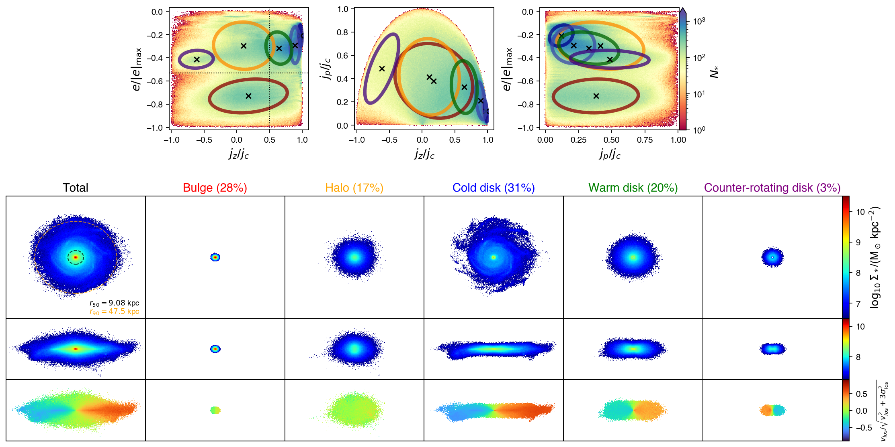
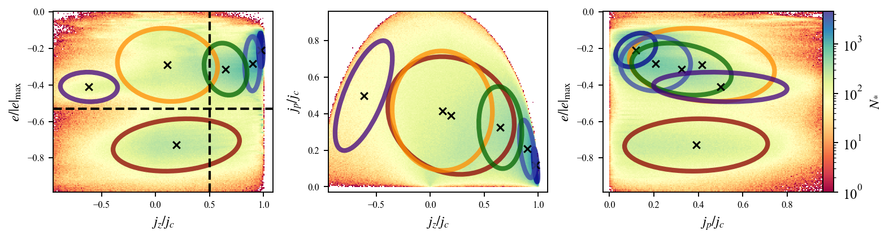
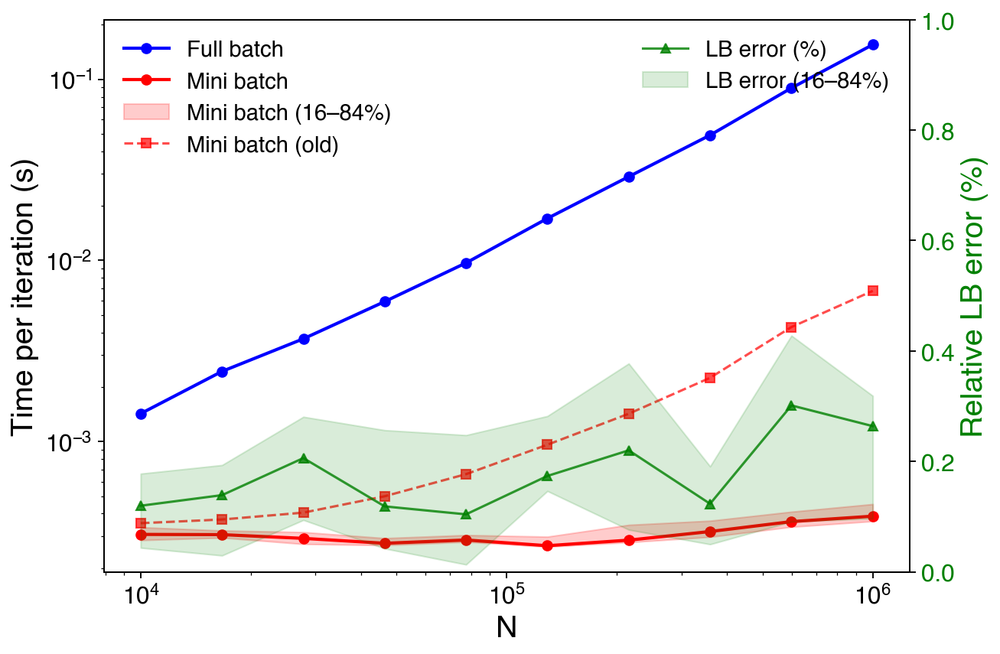
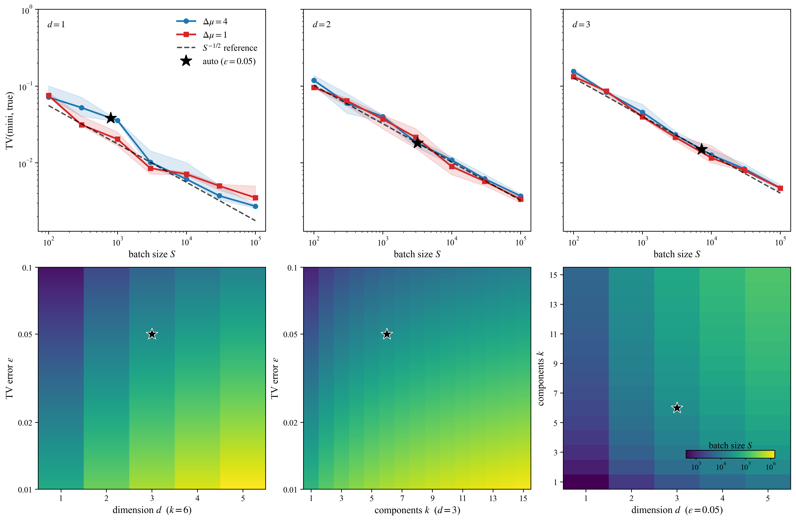

# kinematic-decompose

**Automated kinematic decomposition of galaxies using adaptive Gaussian Mixture Models.**

This package provides an end-to-end pipeline for decomposing simulated galaxies (from cosmological simulations such as IllustrisTNG) into their kinematic components — cold disk, warm disk, bulge, stellar halo, and counter-rotating disk — using an **automated Gaussian Mixture Model (AutoGMM)** approach.



## Overview

Traditional kinematic decomposition methods (e.g., Abadi + JEHistogram) rely on ad-hoc energy and angular momentum cuts. This package replaces hard cuts with an **adaptive, data-driven Gaussian Mixture Model** that:

1. **Automatically classifies morphology** — uses a 3-component GMM to distinguish disks from spheroids based on the $e/|e_{\min}|$–$j_z/j_c$ phase space.
2. **Initializes physically motivated components** — separates bulge, stellar halo, cold disk, warm disk, and counter-rotating disk using energy ($e/|e_{\min}|$) and circularity ($j_z/j_c$) thresholds.
3. **Detects residual underfitting** — uses a 2D histogram-based $\Delta L$ criterion to identify phase-space regions where the current mixture under-represents the data and adds new components automatically.
4. **Supports soft and hard classification** — assigns each star particle a probabilistic or hard label for the five kinematic categories.

## Key Innovations

1. **Adaptive component discovery (AutoGMM)** — the number of Gaussian components is **discovered from the data, not prescribed**: morphology is classified first, residual phase-space regions that the mixture under-represents are detected via a likelihood-ratio criterion, and new components are added until the fit is adequate. The component count is therefore set by the data, never by hand.
2. **Mini-batch EM with N-independent cost** — per-iteration cost scales with `batch_size` instead of the particle count N (~2000× faster per iteration at N = 10⁷), and the converged solutions are **statistically indistinguishable** from full-batch EM (Bayes factor ≈ 1, Jeffreys "no evidence").
3. **Theory-grounded batch size** — the default batch size follows the near-optimal sample complexity of Gaussian mixtures, $\tilde{\Theta}(kd^2/\varepsilon^2)$ (Ashtiani et al. 2020), exposed as a `tv_error` parameter: $S = k\,d^2/\varepsilon^2$ (optional conservative polylog factor). No hand-tuned magic numbers.


### Kinematic Phase Space

The decomposition operates in three dimensions of the stellar orbital phase space:

| Variable | Definition | Description |
|----------|-----------|-------------|
| $e/|e_{\min}|$ | $E / |E_{\min}|$ | Orbital energy normalised by the magnitude of the minimum (most bound) energy; bound particles lie in $[-1, 0)$ |
| $j_z/j_c$ | $L_z / L_c(E)$ | Circularity: z-component of angular momentum over circular angular momentum at same energy |
| $j_p/j_c$ | $L_p / L_c(E)$ | Perpendicular angular momentum fraction |

<p align="center">
  
</p>

### Components

| Component | Phase-space signature |
|-----------|----------------------|
| **Cold disk** | $j_z/j_c > 0.85$ |
| **Warm disk** | $j_z/j_c > 0.5$ |
| **Bulge** | $e/|e_{\min}| < e_{\mathrm{cut}}$ and $|j_z/j_c| < 0.5$ |
| **Stellar halo** | $e/|e_{\min}| > e_{\mathrm{cut}}$ and $|j_z/j_c| < 0.5$ |
| **Counter-rotating disk** | $j_z/j_c < -0.5$ |

$e_{\mathrm{cut}}$ is determined adaptively from the gravitational potential and the stellar energy distribution; the circularity threshold is a fixed 0.5.

## Project Structure

```
kinematic-decompose/
├── src/kinematic_decompose/
│   ├── __init__.py                      # Entry point
│   ├── config.py                        # TNG simulation base path and defaults
│   ├── pipeline.py                      # End-to-end decomposition pipeline
│   ├── visualize.py                     # Publication-quality visualisation (phase space, surface density, LOS velocity)
│   ├── mixture/
│   │   ├── __init__.py
│   │   ├── _base.py                     # Base mixture model (from scikit-learn)
│   │   ├── _gaussian_mixture.py         # Gaussian Mixture Model (extended with soft prediction)
│   │   ├── _auto_gaussian_mixture.py    # **AutoGaussianMixtureModel** — the core algorithm
│   │   ├── preprocessing.py             # RobustScaler for phase-space normalisation
│   │   └── util.py                      # JEHistogram, Ecut, decomposition, structure properties
│   ├── gravity/
│   │   └── kinematic_solver.py          # Agama multipole potential + kinematic parameter calculation
│   └── PyTNG/
│       ├── snapshot_loader.py           # TNG snapshot loader (pynbody-based)
│       ├── derived_array.py             # Derived arrays (energy, angular momentum, etc.)
│       ├── extension.py                 # pynbody extensions (disk/spheroid filters, structural props)
│       ├── tng_config.py                # TNG simulation config
│       ├── simdict_getter.py            # Helper for simulation dict fields
│       └── illustris_python/            # Low-level TNG I/O routines
├── tests/
│   └── example_kinematic_decomposition.ipynb  # Example notebook
├── image/                               # Output and reference images
├── IDEA.md                              # Development notes (Chinese)
├── pyproject.toml
└── README.md
```

## Installation

For using the standard `agama` package together with the repository's
resonance-enabled AGAMAb B build in the Conda environment `resonance`, see
[`bar_structure_decomposition/README_RESONANCE_CONDA.zh-CN.md`](bar_structure_decomposition/README_RESONANCE_CONDA.zh-CN.md).
The two APIs intentionally use `import agama` and `import agamab` and do not
overwrite each other.

### Prerequisites

- Python ≥ 3.11
- [Agama](https://github.com/GalacticDynamics-Oxford/Agama) (optional; only for differential compatibility tests)
- [pynbody](https://pynbody.github.io/) (N-body/SPH snapshot analysis)
- [IllustrisTNG](https://www.tng-project.org/) simulation data access

### Install

The in-tree native potential backend automatically builds and statically links its pinned GSL 2.8 dependency; users do not need to install GSL. A C/C++ compiler, `make`, and internet access on the first build are required. Python dependencies are locked in `uv.lock`. Follow the [native backend build instructions](src/kinematic_decompose/potential/native/README.md), then run `uv sync --locked`.

Agama is not needed for normal installation or pipeline use. To run the optional differential compatibility tests, install the extra with `uv sync --locked --extra agama-compat`.

Only when running optional Agama compatibility tests on macOS with a Homebrew Agama installation, you may need:

```bash
export DYLD_LIBRARY_PATH=/opt/homebrew/opt/libomp/lib
```

## Usage

### Quick Start

```python
from kinematic_decompose.pipeline import kinematic_decomposition_pipeline

model, galaxy, eoemin_cut, jzojc_cut = kinematic_decomposition_pipeline(
    run='TNG50-1',
    snapNum=99,
    subID=307486,
    gravity_potential_path='./potentials/',
    image_path='./images/',
    structure_properties_output_path='./properties/',
    mixture_model_output_path='./models/',
)
```

Potential caches are automatically stored as `{gravity_potential_path}/{run}/{snapNum:03d}/{subID}.ini`, for example `potentials/TNG50-1/099/307486.ini`. Only the cache root is supplied by the user; directories are created automatically, and no metadata sidecar is written. A matching cache is reused by default. Set `force_rebuild_potential=True` to rebuild after changing construction settings or DM mass constants; `gravity_potential_path=None` disables disk caching. Legacy flat `{subID}.ini` files are preserved but never reused or automatically migrated, because their run and snapshot cannot be verified. Exports are validated in a temporary directory on the same filesystem and atomically replace the final file only after success, preserving an existing cache on failure. This scheme isolates runs and snapshots; it does not automatically detect changes to potential settings.

DM particle masses are looked up by full run name using independently checked official high-precision constants in `1e10 Msun/h` (with full Header precision retained where available). Snapshot and cutout loaders use the same table without extra snapshot-Header I/O, rounded fallbacks, or an `mDM_source` property. Unknown runs raise an error. The reported `beta` uses number-weighted raw velocity second moments, `1 - mean(vt**2)/(2*mean(vr**2))`; pynbody's `vt` already includes both tangential components.

### Step-by-step Usage

See [`tests/example_kinematic_decomposition.ipynb`](tests/example_kinematic_decomposition.ipynb) for a complete walkthrough.

```python
from kinematic_decompose.PyTNG.snapshot_loader import Snapshot
from kinematic_decompose.gravity.kinematic_solver import (
    construct_galaxy_potential_model, calculate_kinematic_param
)
from kinematic_decompose.mixture import AutoGaussianMixtureModel, preprocessing, util
from kinematic_decompose.config import BASEPATH
from kinematic_decompose.visualize import visualize_decomposition

# 1. Load a galaxy from TNG
snapshot = Snapshot(f"{BASEPATH}/TNG50-1/output", snapNum=99)
snapshot.load_particle(ID=307486, load_particle_fields='default')
snapshot.physical_units()
snapshot.load_group_catalog(ID=307486)
snapshot.GC_physical_units()
snapshot.center(cen=snapshot.group_catalog['SubhaloPos'])
snapshot.faceon(align_with='star', range=[3*snapshot.properties['eps'], 5*snapshot.s.r50])

# 2. Construct gravitational potential (in-tree Agama-compatible Multipole)
pot = construct_galaxy_potential_model(galaxy)

# 3. Compute kinematic parameters (φ, j_c, e/|e|_max, j_z/j_c, j_p/j_c)
galaxy = calculate_kinematic_param(galaxy, potential=pot)

# 4. Build training data
X = np.column_stack([galaxy.s['eoemin'], galaxy.s['jzojc'], galaxy.s['jpojc']])
keep = (galaxy.s['eoemin'] < 0) & (np.abs(galaxy.s['jzojc']) < 1.5) & (galaxy.s['jpojc'] < 1.5)

# 5. Determine energy cut
sph, _ = util.JEHistogram(galaxy.s['eoemin'][keep], galaxy.s['jzojc'][keep])
eoemin_cut = util.get_Ecut_skewt(galaxy.s['eoemin'][keep][sph], galaxy.s['mass'][keep][sph])

# 6. Normalise and run AutoGMM
scaler = preprocessing.RobustScaler()
X_train = scaler.fit_transform(X[keep])
auto_gmm = AutoGaussianMixtureModel()
auto_gmm.fit(X_train, eoemin_cut=scaler.transform(eoemin_cut, columns=0),
             jzojc_cut=scaler.transform(0.5, columns=1),
             r_jzojc_cut=scaler.transform(-0.5, columns=1),
             sample_weight=galaxy.s['mass'][keep])
best_model = scaler.inverse_transform_GMM(auto_gmm.best_model)

# 7. Decompose the galaxy
galaxy = util.decompose(X, galaxy, best_model, eoemin_cut, jzojc_cut, predict_method='hard')

# 8. Visualise
visualize_decomposition(X, best_model, galaxy, eoemin_cut, jzojc_cut, threshold_line=True)
```

## Potential symmetry and circularity reference

The default model uses spherical DM (`s`, lmax=0), axisymmetric gas (`a`,
lmax=4), and non-axisymmetric stars (`n`, lmax=mmax=4), all with `gridSizeR=30`.
`construct_galaxy_potential_model(galaxy, stellar_symmetry='a')` restores the
old stellar model for controlled comparisons. Particle energies use the full
field. Reference circular orbits use an eight-point azimuthal mean of midplane
potential and radial force, with speeds computed after force averaging. Eight
uniform points remove all nonzero Fourier orders through m=4; four principal
axes alias m=4. Higher-order supplied potentials need `azimuth_samples > mmax`
in `calculate_kinematic_param`. The midplane reference also corresponds to a
z-reflection-symmetrized field. The existing monotone `jc(E)` envelope and
endpoint extrapolation remain; this reference is not a strict angular-momentum
bound in the full non-axisymmetric field, and circularities are not clipped.


## Energy cut: two-component skew-t fit

`util.get_Ecut_skewt(energies, masses)` fits an unweighted, binned Gaussian KDE
with **the standard Scott bandwidth** using bounded, parameter-scaled TRF least
squares (`ftol=xtol=gtol=1e-5`, `max_nfev=600`). To avoid direct per-particle KDE
evaluation, counts are linearly deposited on a fine grid, Gaussian-convolved
with zero padding (no reflected particles), and interpolated onto the 20--100
Freedman--Diaconis fitting-bin centres. The fine-grid spacing is set by a
`1e-4` numerical interpolation tolerance relative to the Gaussian kernel peak,
not by a desired peak count or shape. This is a controlled approximation to
direct KDE, not exact equality. Density is normalised on the fitting grid;
raw counts retain the Poisson residual weights. Component widths and mixture
weight are initialised from the KDE, but no peak-shape or spline constraints
are imposed. Existing parameter bounds are unchanged.

The cut is the component-density crossing between their modes, or their mode
midpoint if no crossing exists. Unresolvable components still use the existing
`get_Ecut` valley fallback. An unusable sample or failed optimisation returns
`None`; optimisation failure emits a warning rather than reporting the initial
guess as a fit. The production pipeline retains its potential-based fallback.
Numerical convergence does not guarantee a globally optimal or accurate
component decomposition. Existing stored catalogues are not recomputed.

## Algorithm: Adaptive Gaussian Mixture Model (AutoGMM)

The core of the package is an **adaptive** GMM: instead of assuming a fixed number of components a priori, it **discovers the kinematic structure from the data** — morphology is classified first, then residual phase-space regions that the current mixture under-represents are detected automatically and new components are added until the model fits. The component count is therefore determined by the data, not by hand.

The custom `GaussianMixture` in `mixture/_gaussian_mixture.py` extends scikit-learn's implementation with:

- **`soft_predict(X)`**: probabilistic label assignment from responsibilities
- **`sample_weight` support**: mass-weighted fitting
- **`min_iter`**: minimum iteration guarantee before convergence check
- **Full precision matrix initialisation** from user-provided `precisions_init`

### AutoGMM Fitting Stages

1. **Morphology classification** — `_morphology_class()`: fits a 3-component GMM on ($e/|e_{\min}|$, $j_z/j_c$). If any component has $\mu_{j_z/j_c} > \text{cut}$, the galaxy is classified as `'disk'`; otherwise `'spheroid'`.

2. **Physical initialisation** — `_initialize()`: maps GMM components to bulge, halo, disk subgroups using energy and circularity cuts. Falls back to data-driven statistics when a morphological subgroup is missing.

3. **Residual component detection** — `_find_residual_component()`: the key innovation. It:
   - Constructs a 2D histogram of the true data in ($e/|e_{\min}|$, $j_z/j_c$)
   - Computes the model-predicted density from the current GMM
   - Calculates $\Delta L = \text{true}\cdot\log(\text{true}/\text{model}) - (\text{true} - \text{model})$ (a likelihood-ratio residual)
   - Thresholds outlier regions and estimates new Gaussian components for each
   - Uses a BIC-like gain criterion to select which new components to keep

4. **Final EM fitting** — runs the full GMM with the automatically determined number of components and initialisation.

## Dependencies

| Package | Minimum Version | Purpose |
|---------|----------------|---------|
| `agama` | optional `agama-compat` extra | Reference implementation for differential compatibility tests; not required at runtime |
| `numpy` | ≥ 2.4.0 | Numerical computing |
| `scipy` | ≥ 1.17.0 | Statistics, interpolation, optimisation |
| `scikit-learn` | ≥ 1.8.0 | GMM base implementation |
| `scikit-image` | ≥ 0.26.0 | Image processing (label, watershed) |
| `pynbody` | ≥ 2.4.0 | Simulation snapshot analysis |
| `pandas` | ≥ 3.0.0 | Data structures (optional, for outputs) |
| `matplotlib` | ≥ 3.10.0 | Visualisation |
| `pytest` | ≥ 9.0.0 | Testing |

## Visualisation

`visualize.py` generates publication-quality multipanel figures:

- **Phase space** (top row): 2D histograms of ($j_z/j_c$, $e/|e_{\min}|$), ($j_z/j_c$, $j_p/j_c$), and ($j_p/j_c$, $e/|e_{\min}|$) with Gaussian ellipses colour-coded by component type.
- **Surface density** (middle row): projected stellar surface density maps ($\log_{10} \Sigma_*$) for each component, with face-on and edge-on views.
- **LOS velocity** (bottom row): line-of-sight stellar velocity maps ($v_{\text{los}} / \sqrt{v_{\text{los}}^2 + 3\sigma_{\text{los}}^2}$).

## Performance: Mini-Batch vs Full-Batch EM

The `GaussianMixture` supports **mini-batch EM whose per-iteration cost is independent of the number of particles**: it scales with `batch_size`, not with N. Full-batch EM must touch every particle each iteration (O(N) per iteration); mini-batch EM works on a fixed-size batch (O(batch) per iteration).

| | Full-batch | Mini-batch |
|---|---|---|
| Per-iteration cost | O(N) | **O(batch) — independent of N** |
| Per-iteration time @ N = 10⁴ | 1.5 ms | 0.4 ms |
| Per-iteration time @ N = 10⁷ | 3.79 s | **1.9 ms (~2000× faster)** |
| Cost growth as N: 10⁴ → 10⁷ (×1000) | ×2500 | **×5** |
| Converged lower bound | reference | within 0.5% (same iteration count) |

<p align="center">
  
</p>

Batch-size selection in one figure: the top row compares measured TV with the
$S^{-1/2}$ reference slope for $d=1$–3, with one shared inset legend. The bottom
row shows the $(d,\varepsilon)$, $(k,\varepsilon)$ and $(d,k)$ parameter planes;
their colors encode the exact auto batch size $S=\lceil kd^2/\varepsilon^2\rceil$
on one common logarithmic scale, with an inset colorbar. The black reference
stars in these maps mark $(k,d,\varepsilon)=(6,3,0.05)$, giving $S=21600$.

<p align="center">
  
</p>

The key enabler is a **theory-grounded batch size**: the default `batch_size` (when not given explicitly) is derived from the near-optimal sample complexity of learning a $k$-Gaussian mixture in $\mathbb{R}^d$ to TV error $\varepsilon$ — $\tilde{\Theta}(kd^2/\varepsilon^2)$ (Ashtiani et al. 2020, Thm 1.5):

$$S = \frac{k\,d^2}{\varepsilon^2}, \qquad \varepsilon = 0.05\ \text{(TV error)},$$

controlled directly by the `tv_error` parameter (smaller $\varepsilon$ → larger batch → mini-batch solution closer to full-batch). An optional conservative polylog factor $\ln(kd/\varepsilon\delta)$ implements the high-probability version (`use_polylog=True`); it is off by default because the expectation-level precision is empirically sufficient. The figure below validates the law on synthetic data: measured TV(mini, true) follows the $\varepsilon \propto \sqrt{kd^2/S}$ slope. The scaling behaviour is verified by `tests/test_gaussian_mixture.py::test_scaling_with_n_samples` (N = 10⁴–10⁶, fixed 10 iterations, mini-batch repeated 10× per N: median curve with 16–84% spread bands). The right axis shows the **Bayes factor** BF = exp(ΔLB) of the full- vs mini-batch converged solutions on a log scale, with the y-range spanning the Jeffreys "no substantial evidence" region [1/3, 3]. The measured BF ≈ 1 (0.96–1.01 in this run) — **no evidence of a difference**: the two convergence paths are statistically indistinguishable, not merely close.

## Visualisation Style

All figures share a unified **Nature-journal style** (`NATURE_STYLE` in `visualize.py`): serif Times New Roman with STIX math fonts, restrained sizes, hairline axes, no grid, 300 dpi output. Surface-density and LOS-velocity maps are binned with an O(N) `searchsorted` + `bincount` routine (no `lexsort`) and rasterised in PDF output, keeping file sizes small.

## Potential Construction Benchmarks

The construction-only benchmark is reproduced with `AGAMA_PYTHON=<agama-python> uv run --no-sync python tests/example_potential_performance.py`. Its [single performance figure](images/potential_performance_scaling.png) plots construction time against $N$, with both legends inside the axes. It contains no potential/force query timings. Analytic accuracy and radial-grid convergence are kept separately in `tests/example_potential_grid_convergence.py` and `tests/example_potential_analytic.py`.

The figure covers spherical (`s`, lmax=mmax=0), axisymmetric (`a`, lmax=4, mmax=0), triaxial (`t`, lmax=mmax=4), and no symmetry (`n`, lmax=mmax=4), using the same seeded triaxial source realization. Color identifies symmetry; the two method labels are `this work` and `Agama`. Only the softened native method is timed; the native no-softening variant is excluded. Defaults are seven source counts from $10^5$ to $10^7$, `gridSizeR=30`, fixed spline support $h=0.02$ kpc, and five repetitions after one warmup. All workers run serially with one thread; timing excludes imports, I/O, warmup and object destruction. Error bars show the 16--84 percentile timing range, not field errors or confidence intervals. Agama uses its standard particle constructor; the different kernels do not imply equal physical accuracy. The square figure contains no title or setup annotations, and its xlabel is only $N$. Use `--native-only` without external Agama, and `--plot-only --results <saved-json>` to redraw cached measurements; legacy caches retain their original construction samples while query measurements are excluded. Raw samples, input digests and binary provenance are saved outside the repository by default; the performance script contains no field profiles or accuracy statistics.

The grid study fixes one $N=10^6$ realization and tests `gridSizeR` = 15, 30, 60, 120, 240. Convergence is measured against the finest tested grid, not an exact continuum solution; analytic errors use method-matched targets. Between 120 and 240, the Agama radial-force change has a 95th percentile of $6.53\times10^{-3}$, so its force-error tail is not fully grid-converged.

The [unified potential-validation figure](images/potential_analytic_models.png) places profiles above signed relative residuals in two columns. The left column uses Agama's `MiyamotoNagai` and triaxial `Ferrers` analytic potential-density pairs with `lmax=mmax=6`; the right uses TNG50-1 snapshot 99, subhalo 715286 with `lmax=mmax=4` and a direct particle sum with the same cubic-spline kernel as the softened field. Both use `gridSizeR=30`. Each upper-panel curve is divided by its own minimum over its sampled radial profile, so its maximum normalized value is 1; the label is $\Phi/\Phi_{\min}$. Lower-panel residuals remain $100(\Phi-\Phi_{\rm ref})/|\Phi_{\rm ref}|$ from the raw potentials, not differences between individually normalized curves. A positive residual means a shallower potential. Both rows share their y axes across columns, displaying y labels and ticks only on the left. Axis labels are 28 pt, ticks 22 pt, legends 20 pt, profile lines 4 pt and residual lines 3 pt. Radial domains retain their physical ranges. MN imposes axisymmetry, Ferrers triaxial symmetry, and the particle comparison imposes no symmetry on any component; this is not a validation of the mixed-symmetry production default. The unsoftened particle residual includes a deliberate kernel change, while the analytic comparison includes finite source-domain, harmonic and softening effects.

Run `AGAMA_PYTHON=<agama-python> uv run --no-sync python tests/example_potential_analytic.py --particle-input <centered-source.npz> --particle-metadata <manifest.json> --results <outside-repo-results.json>` to rebuild the combined figure; omit the particle arguments for the analytic-only profile/error pair. The source NPZ contains physical-kpc positions and solar-mass weights for each manifest component; input and per-component SHA-256 values are verified. `--plot-only --results <saved-json>` redraws cached calculations without recomputing fields. The PNG and vector PDF are generated by the same script; no stored test fixture or separate profile plotting script is required. Permanent regressions are in `tests/test_potential_analytic_models.py`. Deterministic weighted density-quadrature sources retain the three-order, radial-grid, harmonic-order, MN-domain and direct-source checks, including off-axis probes. The real-particle run retains all 335,520 DM/gas/stellar sources, uses spline support $h=0.806023$ kpc, and excludes BH and the external environment. Its softened raw local relative residual has P95 0.07403% and maximum 0.10807% over 321 radii from 0.01 to 10 kpc.

All four potential-validation panels display $0.1\leq r\leq10$ kpc. The particle calculation grid extends to 10 kpc; direct-spline, softened and unsoftened potentials are all recalculated on the same grid, without extrapolation.

## Testing

Run the collected regression suite with `python -m pytest tests -q -rs`.
For optional out-of-process references, set `AGAMA_PYTHON` (analytic models)
and `AGAMA_REFERENCE_PYTHON` (INI/evaluator compatibility) to an Agama-enabled
interpreter. Compatibility checks share exported coefficients and compare the
unchanged off-axis evaluation domain; they do not assert identical particle
fits or reproduce the old reference's origin/axis behavior. Native density,
force-gradient, Cartesian Hessian and near-axis boundary tests validate those
repaired paths independently. The suite no longer includes one-off optimization
comparisons against an unspecified historical binary. Tests are consolidated
by topic; algorithm tests previously requiring explicit example-file selection
are now included in the default collection:

- `tests/test_energy_cut.py` — current skew-t/KDE regressions and the 21 `get_Ecut` initializer/fallback cases across 19 synthetic scenarios; the TRUE (green dashed) vs DETECTED (red solid) visualization remains available by running this file directly.
- `tests/test_gaussian_mixture.py` — GMM behaviour, N-scaling, and all 18 mini-batch sample-complexity and total-variation equivalence tests.
- `tests/test_skew_normal_mixtures.py` — the separately exported `SkewNormalMixtures` API, clustering, energy-cut and performance tests.
- `tests/test_snapshot.py` — cutout loading, filename helpers and periodic centering. Cutout integration tests require the local TNG50-1 data path specified in the file; `tests/test_real_galaxy_smoke.py` separately covers the real-galaxy pipeline.
- `tests/test_calculation_guardrails.py` — pipeline guardrails and the non-axisymmetric, azimuthally averaged circular reference.
- `tests/test_potential_density.py` — density, Poisson consistency, softened convolution and radial multipole moments.
- `tests/test_native_numerics.py` — internal log-density recovery, Cartesian axis Hessians and prepared spline EDF.

Analytic accuracy/Plummer references, external Agama compatibility and performance
plot regressions retain their dedicated test files. The stored `tests/fixtures`
profiles and their one-off plotting script have been removed; analytic benchmarks
generate their own inputs. The catalog example and scientific notebook are retained.

## Reference

If you use this code in your research, please cite the relevant papers:

- **AutoGMM method**: (TODO — add paper reference when published)
- **Batch-size sample complexity**: Ashtiani, Ben-David, Harvey, Liaw, Mehrabian & Plan 2020, [Near-optimal Sample Complexity Bounds for Robust Learning of Gaussian Mixtures via Compression Schemes](https://arxiv.org/abs/1710.05209)
- **IllustrisTNG**: Nelson et al. 2019, [CompAC, 6, 2](https://ui.adsabs.harvard.edu/abs/2019ComAC...6....2N)
- **Agama**: Vasiliev 2019, [MNRAS, 482, 1525](https://ui.adsabs.harvard.edu/abs/2019MNRAS.482.1525V)
- **pynbody**: Pontzen et al. 2013, [ApJS, 239, 39](https://ui.adsabs.harvard.edu/abs/2018MNRAS.473.4025P)

## License

The distributable package, including the native potential extension statically linked with GSL 2.8, is licensed under GPL-3.0-or-later. As in Agama, this does not relicense the original Agama source fragments: their accompanying notice retains their BSD/MIT terms. The GMM implementation in `mixture/_gaussian_mixture.py` and `mixture/_base.py` derives from scikit-learn (BSD-3-Clause); retain all component notices when redistributing.
