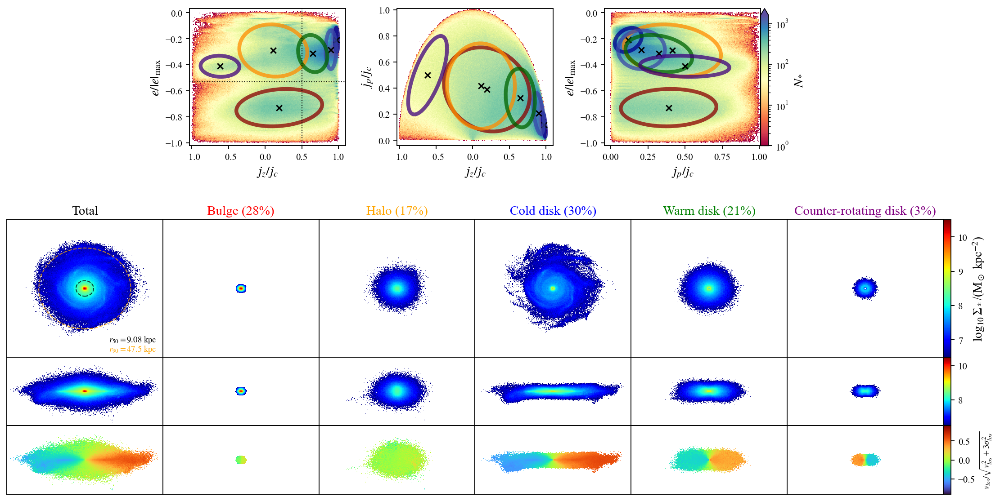
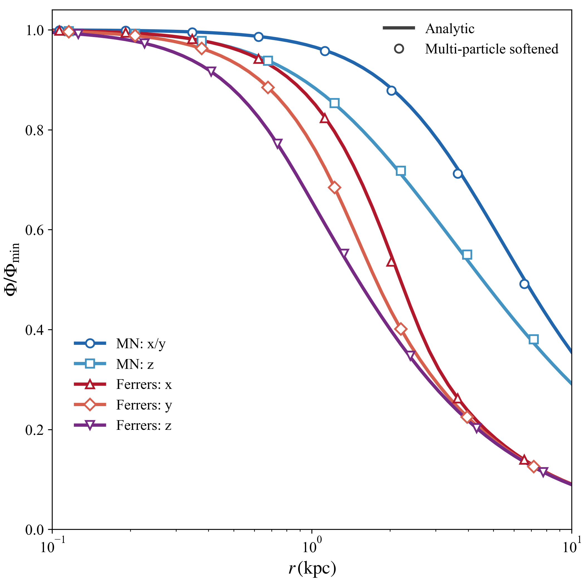

# kinematic-decompose

**从模拟恒星粒子，到星系的运动学结构。**

[English](README.md) · [技术指南](docs/guide.zh-CN.md) · [示例 Notebook](tests/example_kinematic_decomposition.ipynb)

面向 IllustrisTNG 的端到端分解管线：读取星系、构建引力势、计算轨道特征、自适应拟合高斯混合模型，将恒星划分为**核球、恒星晕、冷盘、温盘和反向旋转盘**。



*示例输出。上方为轨道特征空间中的混合模型，下方为整体星系及各运动学结构。点击图片可查看原始分辨率。*

## 核心方法与特色

| 方法 | 解决的问题 |
|---|---|
| **自适应高斯混合模型** | 结合形态初始化与残差检测，在欠拟合区域增加高斯分量，而非为所有星系统一指定分量数。 |
| **自适应能量分界** | 双分量 skew-t 拟合估计核球与恒星晕的能量分界；无法可靠分离或拟合不合适时，采用后备规则。 |
| **Mini-batch EM** | 大样本使用受控大小的粒子批次更新，同时保留 full-batch 对照；批次大小取决于模型复杂度与 `tv_error` 设置。 |
| **软化粒子势场** | 内置基于 Agama 数值核心扩展的 native 后端，支持 cubic-spline 软化与可配置对称性，主流程无需另装 Agama。 |

分解使用三个特征：归一化束缚能量 $e/|e_{\min}|$、圆度 $j_z/j_c$ 和垂直角动量比例 $j_p/j_c$。高斯分量再归入五类物理结构，因此**五类结构不等于五个高斯分量**。方法仍包含明确的分类阈值与数值设置，并非“无参数”。

## 快速开始

需要 **Python 3.11+**、C/C++ 编译器、`make`，以及本地 TNG 快照与 group catalog。首次构建会下载固定版本的 GSL 源码，无需另装系统 GSL。

```bash
git clone https://github.com/quadrup1efish/kinematic-decompose.git
cd kinematic-decompose
uv sync --locked
```

在 [`config.py`](src/kinematic_decompose/config.py) 设置模拟根目录，然后运行：

```python
from kinematic_decompose.pipeline import kinematic_decomposition_pipeline

model, galaxy, energy_cut, circularity_cut = kinematic_decomposition_pipeline(
    run="TNG50-1",
    snapNum=99,
    subID=307486,
    gravity_potential_path="./potentials",
    image_path="./results/images",
    structure_properties_output_path="./results/properties",
    mixture_model_output_path="./results/models",
)
```

输出包括恒星分类、拟合模型、各结构性质和诊断图。势场缓存按模拟与快照隔离，例如 `potentials/TNG50-1/099/307486.ini`；更改势场构造设置后，需设置 `force_rebuild_potential=True`。

## 验证与性能

- **混合模型：** [mini-batch 与 full-batch 对照](images/scaling_performance.png)、[batch-size 测试](images/batch_size.png)及[回归测试](tests/test_gaussian_mixture.py)。
- **势场精度：** [解析模型与真实粒子 direct-sum 对照](images/potential_analytic_models.png)，附[可复现计算代码](tests/example_potential_analytic.py)。
- **势场构建速度：** [native 后端与 Agama 对照](images/potential_performance_scaling.png)，附[基准代码](tests/example_potential_performance.py)。

性能和拟合差异取决于数据、参数与硬件；现有基准不代表所有样本都具有相同加速比，也不保证分类结果完全一致。

运行回归测试：`uv run pytest tests -q -rs`。部分测试需要外部 Agama 参考或本地模拟数据，见[测试说明](docs/guide.zh-CN.md#测试)。

<details>
<summary>展开势场精度对比图</summary>



解析模型与粒子样本使用不同的参考构造及展开阶数，具体设置与限制见[技术指南](docs/guide.zh-CN.md#引力势构建基准测试)。

</details>

## 文档与署名

- [技术指南](docs/guide.zh-CN.md)：算法、势场约定、缓存行为、文献与测试。
- [Native 后端说明](src/kinematic_decompose/potential/native/README.md)：支持的操作、源码来源与构建细节。
- **作者与维护者：** Taiyu Li。实际贡献保留 Git 记录；第三方代码保留原作者署名。
- **许可证：** GPL-3.0-or-later。科研使用请引用软件及相关[方法文献](docs/guide.zh-CN.md#引用)；引用属于学术倡议，不是额外许可限制。
